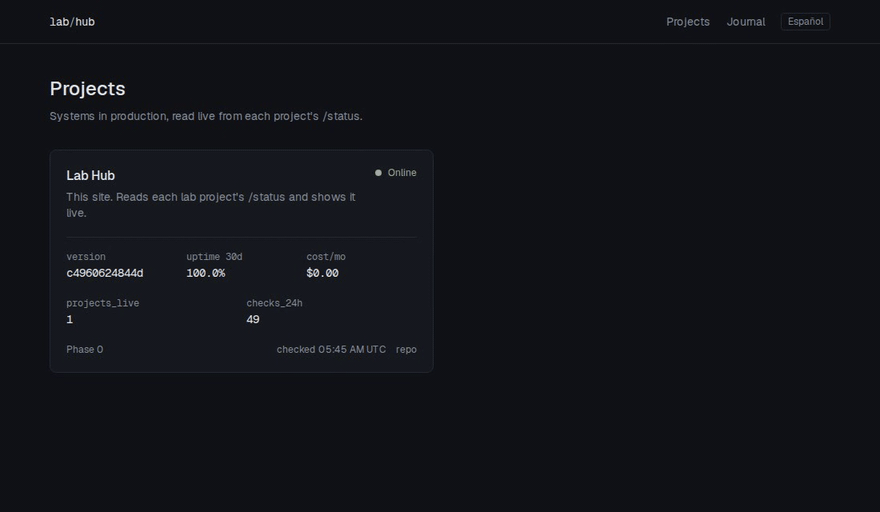

# Lab Hub

**A live portfolio for engineers: every project shown running in production, not in screenshots.**

[Live site](https://lab.beaiapp.com) · [Español](README.es.md) · [Security model](docs/security.md)



Each project publishes a small `lab.yaml` and a `/status` endpoint. The Hub pulls them every 5 minutes and shows live status, version, uptime it measures itself, cost and project metrics. It runs on a single-node k3s homelab behind Cloudflare Tunnel, deploys itself with GitOps, and keeps serving a snapshot when the homelab is down.

## Quickstart (5 minutes)

```bash
git clone https://github.com/AI-experimental-projects/lab-hub && cd lab-hub
pnpm install
pnpm dev          # http://localhost:3000 — the collector starts checking after 15 s
```

Add a project by dropping a file in `content/projects/`:

```yaml
# content/projects/my-api.yaml
name: My API
slug: my-api
phase: 1
summary: What it does, in one line
summary_es: Qué hace, en una línea   # optional
repo: github.com/you/my-api
demo: https://my-api.example.com
status_url: https://my-api.example.com/status
metrics: [requests_24h, p95_latency_ms]
```

Then make `GET /status` return:

```json
{ "ok": true, "version": "1.4.0", "uptime_30d": 0.998, "metrics": { "requests_24h": 1280, "p95_latency_ms": 640 }, "cost_month_usd": 3.1 }
```

`pnpm validate` checks every `lab.yaml` against the contract ([src/lib/contract.ts](src/lib/contract.ts)); unknown fields fail the build so a project can't leak data through it.

## Use it as a template

Click **Use this template**, then point it at your domain and repo:

```bash
node scripts/init.ts --domain lab.example.com --repo you/lab-hub    # --dry-run to preview
```

It rewrites the site URL, the Hub's own `lab.yaml`, the Flux source, the image name and the edge Worker route. Then replace `content/journal/` with your own entries and follow [infra/README.md](infra/README.md) (in Spanish for now) to deploy.

## What's inside

| | |
|---|---|
| **Site** | Next.js 16 (App Router, Cache Components), Tailwind, English by default with Spanish under `/es` |
| **Collector** | Runs in-process every 5 min; results in SQLite (`node:sqlite`). SSRF-safe: contract allows only public `https` domains, DNS is checked and the socket pinned to the checked IP, and a NetworkPolicy only allows public 443 |
| **Pages** | Project cards, a page per project with its check history and an optional MDX write-up, an MDX journal with drafts |
| **Hosting** | k3s on a homelab, exposed only through Cloudflare Tunnel (no open ports); default-deny NetworkPolicies and Pod Security `restricted` |
| **Deploys** | CI validates, tests and builds an image per commit; a bot commits the new tag and Flux rolls it out. GitHub never connects to the cluster |
| **Resilience** | A Cloudflare Worker serves the last snapshot (with a notice) when the homelab is unreachable; `/status` returns 503 so monitors still see the outage |
| **Share** | Generated Open Graph images per page and language, canonical URLs, hreflang, bilingual sitemap |

## Development

```bash
pnpm validate     # lab.yaml contract
pnpm test         # contract, SSRF filter, collector, edge fallback, template init
pnpm lint
pnpm build
```

## License

[MIT](LICENSE)
